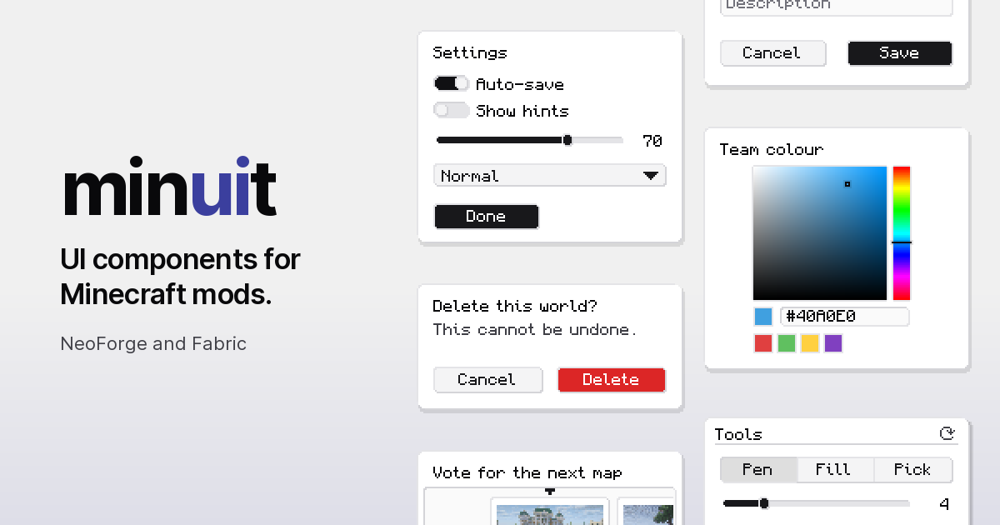
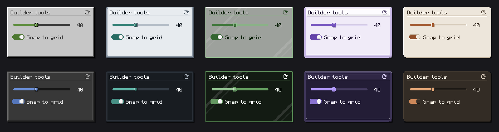

<h1 align="center">minuit</h1>

UI components library for Minecraft mods. Let your players pick their theme!

  <a href="https://minuit.dryaides.com/"><strong>Docs</strong></a> ·
  <a href="https://modrinth.com/mod/minuit"><strong>Modrinth</strong></a> ·
  <a href="https://www.curseforge.com/minecraft/mc-mods/minuit"><strong>CurseForge</strong></a> ·
  <a href="https://discord.gg/Bfv7eMeZcE"><strong>Discord</strong></a>

minuit lets you build your mod's screens from ready components: panels, buttons, toggles, sliders,
dropdowns, lists, tabs and more. Players choose one look for every mod that uses it, among six
theme families, light or dark.

## Contributing

Issues and pull requests are welcome.

## License

MIT, see [LICENSE](LICENSE). The first widgets were inspired by the mod
[Laura](https://www.curseforge.com/minecraft/mc-mods/laura-compagne) by Vyrriox (MIT).
