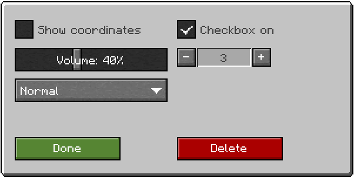

<h1 align="center">minuit</h1>

<p align="center">UI components library for Minecraft mods. Let your players pick their theme!</p>

<p align="center">
  <a href="https://minuit.dryaides.com/"><strong>Docs</strong></a> ·
  <a href="https://modrinth.com/mod/minuit"><strong>Modrinth</strong></a> ·
  <a href="https://www.curseforge.com/minecraft/mc-mods/minuit"><strong>CurseForge</strong></a> ·
  <a href="https://discord.gg/Bfv7eMeZcE"><strong>Discord</strong></a>
</p>


minuit lets you build your mod's screens from ready components: panels, buttons, toggles, sliders,
dropdowns, lists, tabs and more. Players choose one look for every mod that uses it, among five
theme families, light or dark.



## Use it in your mod

```groovy
repositories {
    exclusiveContent {
        forRepository { maven { name = "Modrinth"; url = "https://api.modrinth.com/maven" } }
        filter { includeGroup "maven.modrinth" }
    }
}
dependencies {
    implementation "maven.modrinth:minuit:2.0.1+26.1.2-neoforge" // 2.0.1+<mc>-<loader>
}
```

Paper plugins take `dev.dryaides:minuit-paper-<mc>:2.0.1` from `<MINUIT_MAVEN_URL>` (not published yet).
Per-loader setup: [docs/getting-started](docs/getting-started/README.md). Code assistants: [llms.txt](llms.txt).

## Contributing

Issues and pull requests are welcome.

## License

MIT, see [LICENSE](LICENSE). The first widgets were inspired by the mod
[Laura](https://www.curseforge.com/minecraft/mc-mods/laura-compagne) by Vyrriox (MIT). The Kawaii chroma is
Laura's palette, used with Vyrriox's agreement.
